# OpenGameArt: 3D art

**71 assets from [OpenGameArt](https://opengameart.org), dedicated to the public domain under [CC0](https://creativecommons.org/publicdomain/zero/1.0/).** Use them in any game, free or paid, and change them however you like; no credit is needed.

3D art from OpenGameArt entries licensed CC0 (some also offer other licences; CC0 is the one that applies here). 1.0 GB in all.

This is a copy kept by [zuujis-cc0](https://github.com/zuujis-cc0) so game makers can take single files from GitHub. It is not made by or affiliated with OpenGameArt: the originals, often in more formats and higher resolutions, are on [opengameart.org](https://opengameart.org). If they help you, consider [supporting OpenGameArt](https://opengameart.org/content/faq).

Every file is listed in [MANIFEST.tsv](MANIFEST.tsv) with its size and SHA-256. More free assets: [the Zuujis collection](https://github.com/zuujis-cc0/free-game-assets#readme).

| | | | |
| :-: | :-: | :-: | :-: |
| <a href="modular-wooden-docks">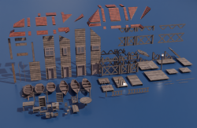</a> <b><a href="modular-wooden-docks">Modular Wooden Docks</a></b> by loafbrr_1 · <a href="https://opengameart.org/content/modular-wooden-docks">source</a> | <a href="muscleboy-3d-model">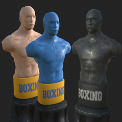</a> <b><a href="muscleboy-3d-model">Muscleboy 3D Model</a></b> by digitaln8m4r3 · <a href="https://opengameart.org/content/muscleboy-3d-model">source</a> | <a href="mutant-grunt">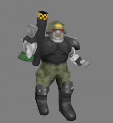</a> <b><a href="mutant-grunt">Mutant Grunt</a></b> by laleksic · <a href="https://opengameart.org/content/mutant-grunt">source</a> | <a href="my-birthday-cake">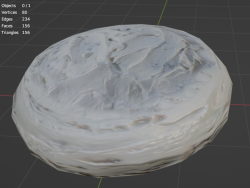</a> <b><a href="my-birthday-cake">My birthday cake.</a></b> by DREAM_SEARCH_REPEAT · <a href="https://opengameart.org/content/my-birthday-cake">source</a> |
| <a href="n64-lasers">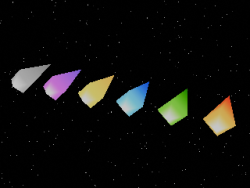</a> <b><a href="n64-lasers">N64 Lasers</a></b> by n64guy · <a href="https://opengameart.org/content/n64-lasers">source</a> | <a href="n64-potions">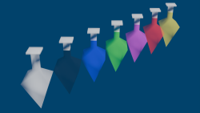</a> <b><a href="n64-potions">N64 Potions</a></b> by n64guy · <a href="https://opengameart.org/content/n64-potions">source</a> | <a href="n64-sign">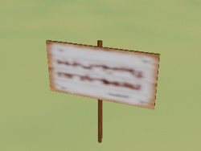</a> <b><a href="n64-sign">N64 Sign</a></b> by n64guy · <a href="https://opengameart.org/content/n64-sign">source</a> | <a href="n64-style-fantasy-guns-weapons-and-items">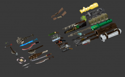</a> <b><a href="n64-style-fantasy-guns-weapons-and-items">N64 Style Fantasy Guns, Weapons, and Items</a></b> by CptDrunkBear · <a href="https://opengameart.org/content/n64-style-fantasy-guns-weapons-and-items">source</a> |
| <a href="office-air-vent">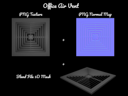</a> <b><a href="office-air-vent">Office Air Vent</a></b> by GeekGirl.Joy · <a href="https://opengameart.org/content/office-air-vent">source</a> | <a href="old-baseball">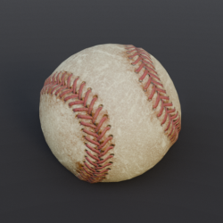</a> <b><a href="old-baseball">Old Baseball</a></b> by LonesomeDucky · <a href="https://opengameart.org/content/old-baseball">source</a> | <a href="old-canon">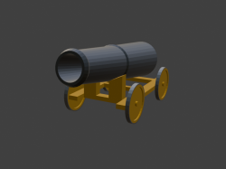</a> <b><a href="old-canon">Old canon</a></b> by tbbk · <a href="https://opengameart.org/content/old-canon">source</a> | <a href="old-house-argentina-1872">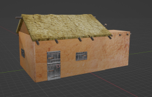</a> <b><a href="old-house-argentina-1872">Old house -Argentina- 1872</a></b> by DREAM_SEARCH_REPEAT · <a href="https://opengameart.org/content/old-house-argentina-1872">source</a> |
| <a href="old-house-argentina-1872-2">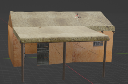</a> <b><a href="old-house-argentina-1872-2">Old house -Argentina- 1872 -2</a></b> by DREAM_SEARCH_REPEAT · <a href="https://opengameart.org/content/old-house-argentina-1872-2">source</a> | <a href="old-kitchenware">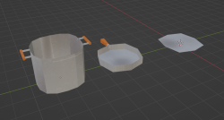</a> <b><a href="old-kitchenware">Old kitchenware</a></b> by DREAM_SEARCH_REPEAT · <a href="https://opengameart.org/content/old-kitchenware">source</a> | <a href="old-shelves">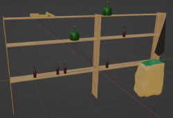</a> <b><a href="old-shelves">Old shelves</a></b> by DREAM_SEARCH_REPEAT · <a href="https://opengameart.org/content/old-shelves">source</a> | <a href="old-wooden-baseball-bat">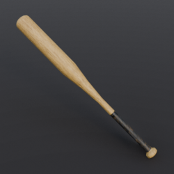</a> <b><a href="old-wooden-baseball-bat">Old Wooden Baseball Bat</a></b> by LonesomeDucky · <a href="https://opengameart.org/content/old-wooden-baseball-bat">source</a> |
| <a href="open-crate">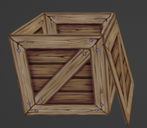</a> <b><a href="open-crate">Open crate</a></b> by Starry Skydancer · <a href="https://opengameart.org/content/open-crate">source</a> |  <b><a href="overscore-proxy-modular-low-poly-female-character-creation-set">OverScore Proxy - Modular Low-Poly Female Character Creation Set</a></b> by overscore_media · <a href="https://opengameart.org/content/overscore-proxy-modular-low-poly-female-character-creation-set">source</a> | <a href="pbr-industrial-asset-pack">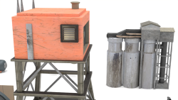</a> <b><a href="pbr-industrial-asset-pack">PBR Industrial Asset Pack</a></b> by a52 · <a href="https://opengameart.org/content/pbr-industrial-asset-pack">source</a> |  <b><a href="penguin-0">Penguin</a></b> by joyfulsquirrel · <a href="https://opengameart.org/content/penguin-0">source</a> |
| <a href="pharmacy-women-care-products">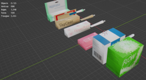</a> <b><a href="pharmacy-women-care-products">Pharmacy women care products</a></b> by DREAM_SEARCH_REPEAT · <a href="https://opengameart.org/content/pharmacy-women-care-products">source</a> | <a href="pipe-0">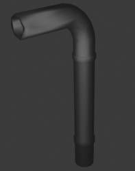</a> <b><a href="pipe-0">Pipe</a></b> by neincenets · <a href="https://opengameart.org/content/pipe-0">source</a> | <a href="pirate-low-poly-pistol-gun">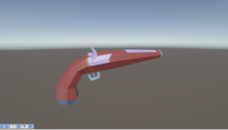</a> <b><a href="pirate-low-poly-pistol-gun">Pirate Low Poly Pistol Gun</a></b> by victordelima · <a href="https://opengameart.org/content/pirate-low-poly-pistol-gun">source</a> | <a href="pistol-animations-sounds-for-godot">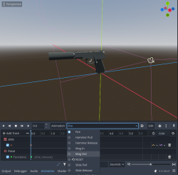</a> <b><a href="pistol-animations-sounds-for-godot">Pistol, animations, sounds for GoDot</a></b> by MilitaryG · <a href="https://opengameart.org/content/pistol-animations-sounds-for-godot">source</a> |
| <a href="pixel-art-building">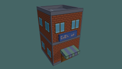</a> <b><a href="pixel-art-building">Pixel art building</a></b> by humble squirrel · <a href="https://opengameart.org/content/pixel-art-building">source</a> | <a href="plastic-cart">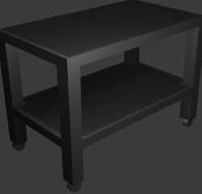</a> <b><a href="plastic-cart">Plastic Cart</a></b> by neincenets · <a href="https://opengameart.org/content/plastic-cart">source</a> | <a href="plate-with-food">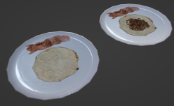</a> <b><a href="plate-with-food">plate with food</a></b> by DREAM_SEARCH_REPEAT · <a href="https://opengameart.org/content/plate-with-food">source</a> | <a href="polygon-world-0">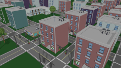</a> <b><a href="polygon-world-0">Polygon World</a></b> by joyfulsquirrel · <a href="https://opengameart.org/content/polygon-world-0">source</a> |
| <a href="poopwars-hooman">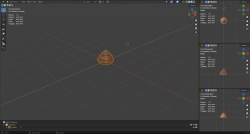</a> <b><a href="poopwars-hooman">PoopWars Hooman</a></b> by cottonball · <a href="https://opengameart.org/content/poopwars-hooman">source</a> | <a href="porcelain-jar">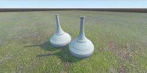</a> <b><a href="porcelain-jar">Porcelain Jar</a></b> by CharlExMachina · <a href="https://opengameart.org/content/porcelain-jar">source</a> | <a href="post-soviet-fence-po-2-and-grate">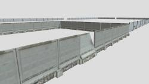</a> <b><a href="post-soviet-fence-po-2-and-grate">Post-soviet fence PO-2 and grate</a></b> by Mixazzz · <a href="https://opengameart.org/content/post-soviet-fence-po-2-and-grate">source</a> | <a href="pot-with-meat">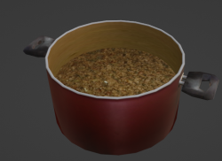</a> <b><a href="pot-with-meat">Pot with meat</a></b> by DREAM_SEARCH_REPEAT · <a href="https://opengameart.org/content/pot-with-meat">source</a> |
| <a href="pot-with-polenta">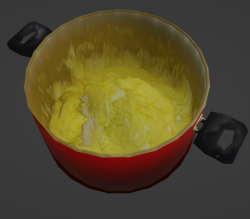</a> <b><a href="pot-with-polenta">Pot with polenta</a></b> by DREAM_SEARCH_REPEAT · <a href="https://opengameart.org/content/pot-with-polenta">source</a> | <a href="pot-with-ravioli">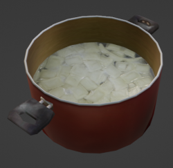</a> <b><a href="pot-with-ravioli">Pot with ravioli</a></b> by DREAM_SEARCH_REPEAT · <a href="https://opengameart.org/content/pot-with-ravioli">source</a> | <a href="pot-with-soup">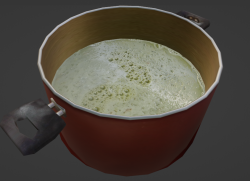</a> <b><a href="pot-with-soup">Pot with soup</a></b> by DREAM_SEARCH_REPEAT · <a href="https://opengameart.org/content/pot-with-soup">source</a> |  <b><a href="professional-speaker">"Professional Speaker"</a></b> by PushDXT · <a href="https://opengameart.org/content/professional-speaker">source</a> |
| <a href="ps1-style-caveman-3d-model-rigged">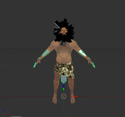</a> <b><a href="ps1-style-caveman-3d-model-rigged">PS1 style Caveman 3D model [rigged]</a></b> by mujtaba-io · <a href="https://opengameart.org/content/ps1-style-caveman-3d-model-rigged">source</a> | <a href="ps1-trees">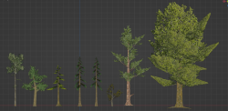</a> <b><a href="ps1-trees">Ps1 Trees</a></b> by Starry Skydancer · <a href="https://opengameart.org/content/ps1-trees">source</a> | <a href="pulperia-argentinian-1870s-country-shop">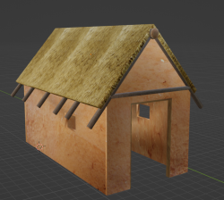</a> <b><a href="pulperia-argentinian-1870s-country-shop">Pulperia -Argentinian 1870's country shop</a></b> by DREAM_SEARCH_REPEAT · <a href="https://opengameart.org/content/pulperia-argentinian-1870s-country-shop">source</a> | <a href="ramen">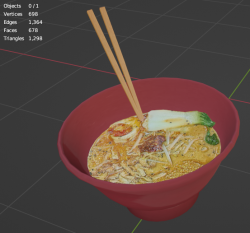</a> <b><a href="ramen">Ramen</a></b> by DREAM_SEARCH_REPEAT · <a href="https://opengameart.org/content/ramen">source</a> |
| <a href="ravioli-with-tomato-sauce-and-cheese">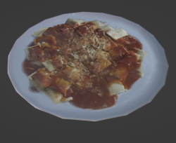</a> <b><a href="ravioli-with-tomato-sauce-and-cheese">Ravioli with tomato sauce and cheese.</a></b> by DREAM_SEARCH_REPEAT · <a href="https://opengameart.org/content/ravioli-with-tomato-sauce-and-cheese">source</a> |  <b><a href="rayman-inspired-plants">Rayman inspired plants</a></b> by Starry Skydancer · <a href="https://opengameart.org/content/rayman-inspired-plants">source</a> | <a href="residential-building-lowpoly-apartment-block">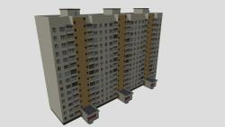</a> <b><a href="residential-building-lowpoly-apartment-block">Residential building (lowpoly apartment block)</a></b> by Mixazzz · <a href="https://opengameart.org/content/residential-building-lowpoly-apartment-block">source</a> | <a href="retro-world-64">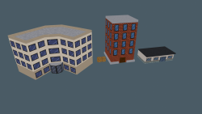</a> <b><a href="retro-world-64">Retro World 64</a></b> by joyfulsquirrel · <a href="https://opengameart.org/content/retro-world-64">source</a> |
| <a href="rifle-scope">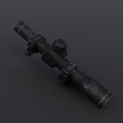</a> <b><a href="rifle-scope">Rifle Scope</a></b> by LonesomeDucky · <a href="https://opengameart.org/content/rifle-scope">source</a> | <a href="rough-chess-piece">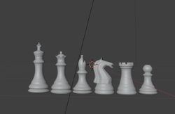</a> <b><a href="rough-chess-piece">Rough Chess Piece</a></b> by Lyricsz · <a href="https://opengameart.org/content/rough-chess-piece">source</a> | <a href="sandwich">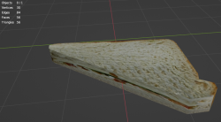</a> <b><a href="sandwich">Sandwich</a></b> by DREAM_SEARCH_REPEAT · <a href="https://opengameart.org/content/sandwich">source</a> | <a href="santa-claus-2">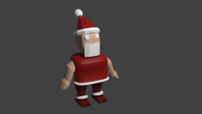</a> <b><a href="santa-claus-2">Santa Claus</a></b> by Lyricsz · <a href="https://opengameart.org/content/santa-claus-2">source</a> |
|  <b><a href="school-from-moscow-lowpoly-building">School from Moscow (lowpoly building)</a></b> by Mixazzz · <a href="https://opengameart.org/content/school-from-moscow-lowpoly-building">source</a> | <a href="sci-fi-wall-light">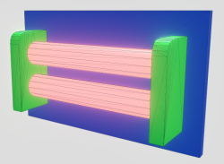</a> <b><a href="sci-fi-wall-light">Sci-Fi Wall Light</a></b> by Eponasoft · <a href="https://opengameart.org/content/sci-fi-wall-light">source</a> | <a href="scifi-hoverships">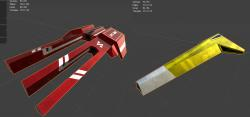</a> <b><a href="scifi-hoverships">SciFi Hoverships</a></b> by knekko · <a href="https://opengameart.org/content/scifi-hoverships">source</a> | <a href="security-camera-cctv">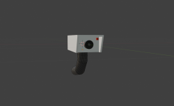</a> <b><a href="security-camera-cctv">Security camera | CCTV</a></b> by Zxelt · <a href="https://opengameart.org/content/security-camera-cctv">source</a> |
| <a href="sexual-lubricants">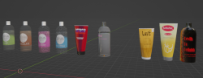</a> <b><a href="sexual-lubricants">Sexual lubricants</a></b> by DREAM_SEARCH_REPEAT · <a href="https://opengameart.org/content/sexual-lubricants">source</a> | <a href="sildenafil">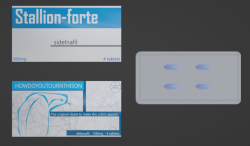</a> <b><a href="sildenafil">Sildenafil</a></b> by DREAM_SEARCH_REPEAT · <a href="https://opengameart.org/content/sildenafil">source</a> | <a href="silver-chest-texture-animation">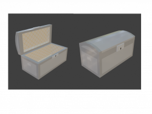</a> <b><a href="silver-chest-texture-animation">Silver chest + texture + animation</a></b> by Giovane29Dev · <a href="https://opengameart.org/content/silver-chest-texture-animation">source</a> |  <b><a href="simple-3d-dagger">Simple 3d Dagger</a></b> by daniloMattos · <a href="https://opengameart.org/content/simple-3d-dagger">source</a> |
|  <b><a href="simple-water-bottle">Simple Water Bottle</a></b> by NotionHD · <a href="https://opengameart.org/content/simple-water-bottle">source</a> |  <b><a href="single-drawer">Single drawer</a></b> by DREAM_SEARCH_REPEAT · <a href="https://opengameart.org/content/single-drawer">source</a> |  <b><a href="small-food-pack">small food pack.</a></b> by DREAM_SEARCH_REPEAT · <a href="https://opengameart.org/content/small-food-pack">source</a> |  <b><a href="snacks-0">snacks</a></b> by DREAM_SEARCH_REPEAT · <a href="https://opengameart.org/content/snacks-0">source</a> |
|  <b><a href="sneaky-spy">Sneaky Spy</a></b> by Eldritch Grim · <a href="https://opengameart.org/content/sneaky-spy">source</a> |  <b><a href="some-more-random-food">Some more random food.</a></b> by DREAM_SEARCH_REPEAT · <a href="https://opengameart.org/content/some-more-random-food">source</a> |  <b><a href="spaceships-9">Spaceships</a></b> by DREAM_SEARCH_REPEAT · <a href="https://opengameart.org/content/spaceships-9">source</a> |  <b><a href="spaghetti-with-bolognese">Spaghetti with bolognese</a></b> by DREAM_SEARCH_REPEAT · <a href="https://opengameart.org/content/spaghetti-with-bolognese">source</a> |
|  <b><a href="spark-dork">Spark Dork</a></b> by MarshReaper · <a href="https://opengameart.org/content/spark-dork">source</a> |  <b><a href="steak-and-salad">Steak and salad</a></b> by DREAM_SEARCH_REPEAT · <a href="https://opengameart.org/content/steak-and-salad">source</a> |  <b><a href="stews">Stews</a></b> by DREAM_SEARCH_REPEAT · <a href="https://opengameart.org/content/stews">source</a> |  <b><a href="strange-artifact">Strange Artifact</a></b> by creatorbyte · <a href="https://opengameart.org/content/strange-artifact">source</a> |
|  <b><a href="strange-egg">Strange Egg</a></b> by Umplix · <a href="https://opengameart.org/content/strange-egg">source</a> |  <b><a href="strong-man">Strong Man</a></b> by byzmod3d · <a href="https://opengameart.org/content/strong-man">source</a> |  <b><a href="stump">Stump</a></b> by Mish7913 · <a href="https://opengameart.org/content/stump">source</a> |  |

---

Kept up to date by this repository's own [update workflow](.github/workflows/update.yml), with code and plan from [cc0-mirror](https://github.com/zuujis-cc0/cc0-mirror). Something wrong? [Open an issue there](https://github.com/zuujis-cc0/cc0-mirror/issues/new) or use the [private report form](https://games.zuujis.com/report).
